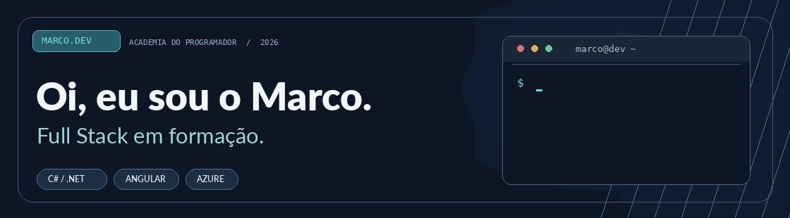
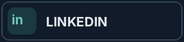
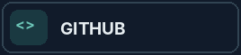
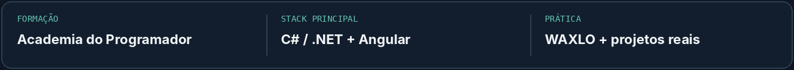
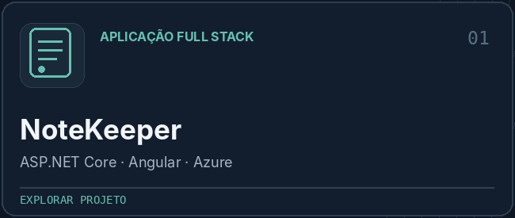
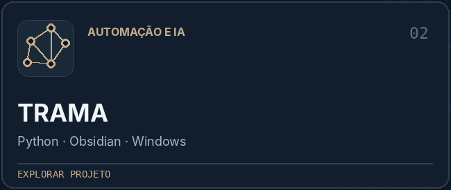
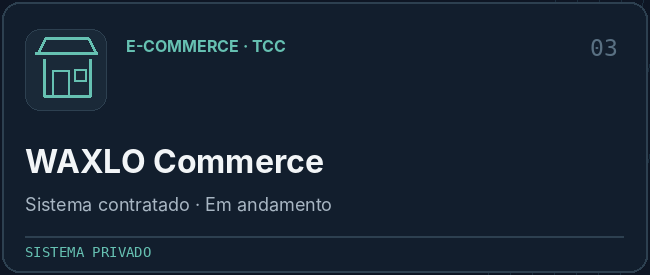
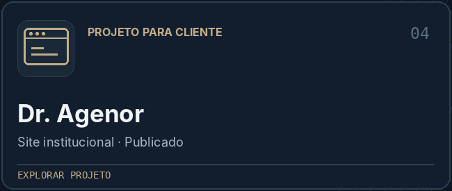

     
     
 

 

   
     

Sobre mim
Sou Marco Oliveira, de Lages/SC. Estou no último mês da Academia do Programador, na formação Full Stack, e curso Sistemas de Informação na UNIPLAC. Também sou formado como Técnico em Informática pelo CEDUP.

Na WAXLO, desenvolvo sites e soluções digitais para clientes. Atualmente, trabalho no WAXLO Commerce, um sistema de e-commerce contratado por uma loja de Lages, com integração à Nuvemshop. O projeto está em desenvolvimento e também faz parte do meu TCC.

Meu foco é construir software de ponta a ponta, com especial interesse em C# / .NET, Angular, APIs e cloud, utilizando também ferramentas de IA e desenvolvimento agêntico no fluxo de trabalho.

Tecnologias e ferramentas

     
     <b>Back-end</b> · C# / ASP.NET Core / APIs REST   |   <b>Cloud</b> · Azure / GitHub Actions / Vercel

<b>Front-end</b> · Angular / Tailwind   |   <b>IA</b> · Claude Code / OpenSpec / fluxo agêntico

Projetos selecionados

Uma seleção de projetos acadêmicos, aplicações próprias e trabalhos desenvolvidos para clientes.
<table>
  <tr>
    <td width="50%" align="center" valign="top">
      
      
<strong>NoteKeeper</strong> Projeto acadêmico com API ASP.NET Core, Angular, autenticação e publicação na Azure.

      <a href="https://github.com/Marco-Oliver/notekeeper-2026"><strong>Repositório e documentação</strong></a>
    </td>
    <td width="50%" align="center" valign="top">
      
      
<strong>TRAMA</strong> Aplicação Windows para conectar aulas, transcrições, código e conhecimento no Obsidian.

      <a href="https://github.com/Marco-Oliver/TRAMA"><strong>Repositório e releases</strong></a>
    </td>
  </tr>
  <tr>
    <td width="50%" align="center" valign="top">
      
      
<strong>WAXLO Commerce</strong> Solução de e-commerce para loja de Lages/SC, integrada à Nuvemshop. TCC em desenvolvimento; código privado.

      <a href="https://mud-store.vercel.app"><strong>Ver interface pública da loja</strong></a> 
      A demonstração é da loja, não do sistema privado de gestão.
    </td>
    <td width="50%" align="center" valign="top">
      
      
<strong>Site Dr. Agenor</strong> Site institucional para cliente, com conteúdo multimídia e publicação na Vercel.

      <a href="https://site-dr-agenor.vercel.app"><strong>Visualizar site</strong></a> · <a href="https://github.com/Marco-Oliver/site-dr-agenor">Código</a>
    </td>
  </tr>
</table>

  
<strong>Mais sobre minha formação e como desenvolvo</strong> &nbsp; (clique para abrir)

  
<strong>Formação</strong>

  <ul>
    <li><strong>Academia do Programador:</strong> formação Full Stack, conclusão prevista em dezembro de 2026.</li>
    <li><strong>UNIPLAC:</strong> graduação em Sistemas de Informação, em andamento.</li>
    <li><strong>CEDUP:</strong> Técnico em Informática integrado ao Ensino Médio, concluído.</li>
  </ul>  
<strong>Práticas e ferramentas</strong>

  <ul>
    <li>Aplicações web com .NET, Angular, bancos de dados e integrações de APIs.</li>
    <li>Controle de versão, testes, CI/CD e deploy de aplicações na Azure.</li>
    <li>Desenvolvimento assistido por IA, agentes de código, documentação e validação incremental.</li>
  </ul>

  Da formação à prática: aprendendo, construindo e evoluindo com software real.
   
   
  <a href="https://www.linkedin.com/in/marco-antonio-de-oliveira-rodrigues-072136376/">LinkedIn</a>
  &nbsp;·&nbsp;
  <a href="https://github.com/Marco-Oliver?tab=repositories">Todos os projetos</a>
  &nbsp;·&nbsp;
  <a href="https://github.com/netos-do-velho-barrero">Projetos da Academia</a>

