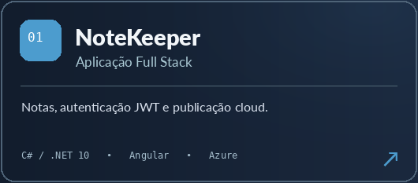
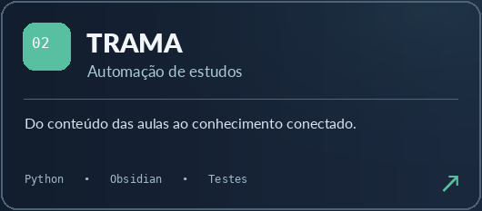
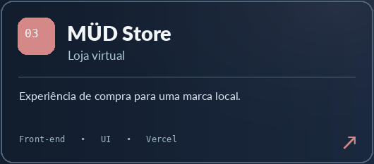
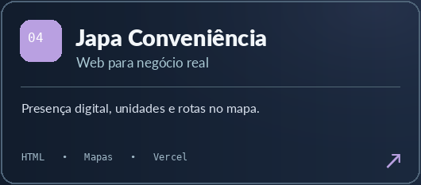

  
    
  
  
  

👋 Um pouco sobre mim
Sou Marco Oliveira, de Lages, Santa Catarina. Estou concluindo a formação Full Stack pela Academia do Programador e curso Sistemas de Informação na UNIPLAC. Também sou técnico em Informática pelo CEDUP.

Na WAXLO, desenvolvo sites e soluções digitais para clientes. Atualmente trabalho no WAXLO Commerce, uma solução de e-commerce para uma loja de Lages, com integração à Nuvemshop. O projeto está em desenvolvimento e também faz parte do meu TCC.

Meu foco é evoluir como desenvolvedor Full Stack, com atenção especial ao ecossistema C# / .NET, aplicações web e entregas de software.
<table>
  <tr>
    <td width="50%" valign="top">
      <h3>🎓 Formação</h3>
      
🟢 <strong>Academia do Programador</strong> Full Stack · Conclusão prevista: dez/2026

      
🔵 <strong>UNIPLAC</strong> Sistemas de Informação · Cursando

      
⚪ <strong>CEDUP</strong> Técnico em Informática · Concluído

    </td>
    <td width="50%" valign="top">
      <h3>⚡ Hoje estou focado em</h3>
      
→ Desenvolvimento com <strong>.NET e Angular</strong>

      
→ Integrações de APIs e aplicações reais

      
→ <strong>Azure</strong>, CI/CD e deploy

      
→ Fluxos de desenvolvimento assistidos por <strong>IA e agentes</strong>

    </td>
  </tr>
</table>🚀 Projetos que contam minha história
<!-- Clique nos cards para conhecer cada repositório. -->
<table>
  <tr>
    <td width="50%" align="center" valign="top"></td>
    <td width="50%" align="center" valign="top"></td>
  </tr>
  <tr>
    <td width="50%" align="center" valign="top"></td>
    <td width="50%" align="center" valign="top"></td>
  </tr>
</table>

  
<strong>🔎 Ver mais sobre os projetos</strong> · clique para expandir

Projeto	O que você encontra
NoteKeeper	Aplicação acadêmica Full Stack com ASP.NET Core, Angular, SQL Server, autenticação JWT e deploy na Azure.
TRAMA	Aplicação Windows de apoio a estudos, com organização de conteúdos, integração ao Obsidian e automações.
MÜD Store	Projeto público da interface web de uma loja virtual.
Japa Conveniência	Site para negócio local, com informações das unidades, mapas e presença digital.

O WAXLO Commerce é um sistema contratado ainda em desenvolvimento. Seu código de produção não está apresentado aqui como repositório público.

🧩 Tecnologias & práticas
<table>
  <tr>
    <td width="25%"><strong>Back-end</strong></td>
    <td>C# · .NET · ASP.NET Core · Entity Framework Core · APIs REST</td>
  </tr>
  <tr>
    <td><strong>Front-end</strong></td>
    <td>Angular · HTML · CSS · Tailwind CSS</td>
  </tr>
  <tr>
    <td><strong>Dados & integração</strong></td>
    <td>SQL Server · PostgreSQL · RabbitMQ · APIs externas</td>
  </tr>
  <tr>
    <td><strong>Cloud & fluxo</strong></td>
    <td>Azure · Git · GitHub · GitHub Actions · Docker · Vercel</td>
  </tr>
  <tr>
    <td><strong>IA & agentes</strong></td>
    <td>Claude Code · OpenSpec · desenvolvimento assistido por IA · organização de requisitos</td>
  </tr>
</table>

  
<strong>🛠️ Como gosto de desenvolver</strong> · clique para expandir

- Entender antes de implementar: organizar requisitos, documentar decisões e separar problemas em etapas.
- Construir e validar: usar Git, testes, análise de erros e entregas incrementais.
- Aprender com projetos reais: conectar conteúdo estudado a aplicações e integrações concretas.
- Usar IA com responsabilidade: acelerar análise, documentação e implementação, revisando e testando os resultados.

  Desenvolvimento de software é aprendizado contínuo — e eu gosto de transformar aprendizado em produto.
    
  <a href="https://www.linkedin.com/in/marco-antonio-de-oliveira-rodrigues-072136376/">LinkedIn</a> ·
  <a href="https://github.com/Marco-Oliver?tab=repositories">Repositórios</a> ·
  <a href="https://github.com/Marco-Oliver/TRAMA">TRAMA</a>

